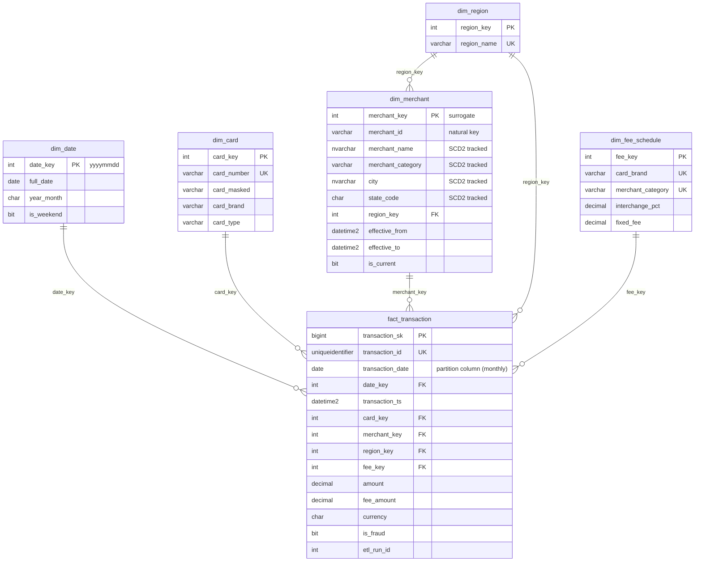
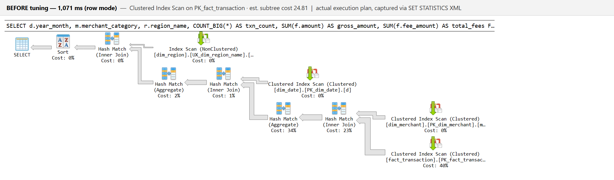
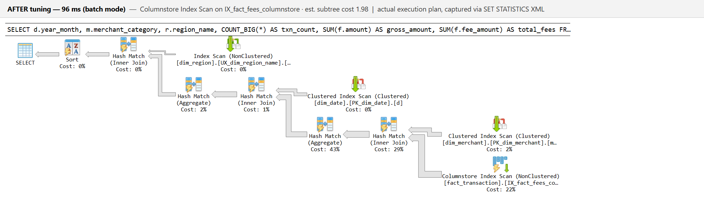

# Settlement Warehouse — Payments ETL on SQL Server

**A production-style payments data warehouse built from scratch:** 1M+ synthetic
card transactions flow through a Python **extract → stage → validate →
transform → load** pipeline into a **partitioned star schema** on SQL Server,
with SCD Type 2 history, watermark-based incremental loading, a full audit
trail, and a measured **11x query-tuning win** using a columnstore index.

Built and verified end-to-end by **Tharun Varada** · Python 3.12 · T-SQL ·
SQL Server 2019 (Express/LocalDB) · pyodbc/SQLAlchemy · pytest

---

## Headline results (all measured, not estimated)

| Metric | Result |
|---|---|
| Full load throughput | **1,001,027 rows read → 995,952 loaded in 38 seconds** (BULK INSERT + set-based T-SQL) |
| Data quality gate | **5,075 bad rows caught** by 10 validation rules — zero invalid rows reached the star schema |
| Reconciliation | Every run balances to the row: `read = loaded + rejected + skipped + already-in-target` |
| Idempotency | Re-running the same batch loads **0 duplicate rows** (proven live + under test) |
| Query tuning | Monthly-fees aggregation: **1,071 ms → 96 ms (11x)** via nonclustered columnstore index |
| Partitioning | Fact table spread across **20 monthly partitions**, all indexes partition-aligned |
| Tests | **14/14 passing** — one per validation rule + idempotency, watermark, and SCD2 behavior |

## What this project demonstrates

- **Dimensional modeling** — star schema with surrogate keys, conformed dimensions, a fee-schedule dimension driving computed measures (`fee_amount = amount × interchange_pct + fixed_fee`)
- **Slowly Changing Dimensions (Type 2)** — merchant history versioned with `effective_from/to` + `is_current`, implemented with `MERGE ... OUTPUT`
- **Table partitioning** — monthly `RANGE RIGHT` partition function/scheme on the fact table with aligned rowstore *and* columnstore indexes
- **ETL engineering** — staged loading, set-based validation, reject quarantine with full row payloads, run auditing, watermark-driven incremental loads
- **Performance tuning** — captured actual execution plans before/after, diagnosed row-mode scan bottleneck, fixed with batch-mode columnstore
- **Testing discipline** — pytest integration suite against a disposable test database

## Architecture

```
 etl/generate.py                 Python ETL (etl/run.py)                    SQL Server
┌───────────────┐   ┌──────────────────────────────────────────┐   ┌───────────────────────┐
│ merchants.csv │──▶│ EXTRACT   verify files, count source rows│   │ stage_transaction_raw │
│ transactions  │──▶│ STAGE     BULK INSERT → raw → typed stage├──▶│ stage_transaction     │
│    .csv       │   │           (watermark filter, incremental)│   │ stage_merchant        │
└───────────────┘   │ VALIDATE  nulls/format/range/duplicates  │   ├───────────────────────┤
                    │ TRANSFORM dims: SCD2 MERGE + card MERGE  ├──▶│ dim_* (star)          │
                    │ VALIDATE  referential integrity vs dims  │   │ rejected_rows         │
                    │ LOAD      MERGE into partitioned fact,   ├──▶│ fact_transaction      │
                    │           advance watermark, reconcile   │   │ etl_run_log/watermark │
                    └──────────────────────────────────────────┘   └───────────────────────┘
```

## ERD (star schema)



### Physical design

- **Partitioning**: `fact_transaction` partitioned monthly by `transaction_date`
  (`pf_txn_month` / `ps_txn_month`, RANGE RIGHT, 2024-01 … 2027-01)
- **Clustered** PK on `(transaction_date, transaction_sk)`
- **Nonclustered**: unique `(transaction_id, transaction_date)` as the
  idempotency guard, FK-support indexes, and a partition-aligned columnstore
  for analytics (added by the tuning exercise below)

---

## Proof: it actually runs

Everything below is captured output from real runs on this codebase
(Windows 11, SQL Server 2019 Express LocalDB, Python 3.12).

### 1. Full load — 1M rows in 38 seconds, reconciled to the row

`python -m etl.run --full` summary (verbatim):

```json
{
  "rows_read": 1001027,
  "loaded": 995952,
  "rejected": 5075,
  "reconciled": true,
  "run_id": 1,
  "mode": "full",
  "rule_counts": {
    "null_required_column": 1036,
    "invalid_or_out_of_range_date": 960,
    "invalid_or_out_of_range_amount": 1009,
    "duplicate_transaction_id": 1027,
    "ri_merchant_not_found": 1043
  },
  "dim_counts": { "dim_merchant_changed": 2000, "dim_card_inserted": 99989 }
}
```

The generator deliberately injects ~0.5% dirty rows (nulls, duplicates,
out-of-range amounts/dates, orphan merchant ids); every one was caught by the
matching rule and quarantined in `rejected_rows` with its JSON payload, the
rule name, and a timestamp. 1,036 + 960 + 1,009 + 1,027 + 1,043 = 5,075 —
plus 995,952 loaded = 1,001,027 read. **Nothing unaccounted for.**

### 2. Audit trail — `dbo.etl_run_log` after the demo sequence

```
run_id  mode         rows_read  loaded   rejected  status
1       full         1,001,027  995,952  5,075     success
2       incremental     50,064   49,807    239      success
3       incremental     50,064        0     36      success   <- same batch replayed
```

Run 3 is the **idempotency proof**: the exact same 50K-row file replayed —
the watermark skipped 50,027 already-loaded rows, the fact `MERGE` matched
the boundary row, and **zero rows were inserted** while reconciliation still
balanced. Warehouse state after: **1,045,759 fact rows across 20 monthly
partitions**, 2,000 current merchants (4,000 SCD2 versions), ~105K cards.

### 3. Query tuning — 11x, with captured execution plans

Query: monthly fees by merchant category and region (`perf/slow_query.sql`) —
fact joined to date/merchant/region, grouped by month × category × region.
Measured warm-cache by `python -m perf.capture_perf` over 995,952 fact rows:

| | elapsed (warm) | fact table access | execution mode | est. subtree cost |
|---|---|---|---|---|
| **Before** | 1,071 ms | Clustered Index Scan on `PK_fact_transaction` | Row | 24.81 |
| **After** | 96 ms | Index Scan on `IX_fact_fees_columnstore` | Batch | 1.98 |

The diagnosis: with only rowstore indexes, the aggregation forces a row-mode
scan of the full clustered index — all 14 columns of ~1M rows read to sum 5
of them. A first attempt with a covering rowstore index gained only ~2%
(scan cost dominates, not column width at this scale). The correct fix is a
**partition-aligned nonclustered columnstore index** over exactly the queried
columns (`perf/fix_index.sql`):

```sql
CREATE NONCLUSTERED COLUMNSTORE INDEX IX_fact_fees_columnstore
    ON dbo.fact_transaction (date_key, merchant_key, region_key, amount, fee_amount)
    ON ps_txn_month (transaction_date);
```

The plan flips to a batch-mode columnstore scan with aggregate pushdown —
the right index shape for `GROUP BY`/`SUM` analytics — while the rowstore
clustered index keeps serving point lookups. The actual plans are captured to
`perf/plan_before.sqlplan` / `perf/plan_after.sqlplan` (open in SSMS).





*Both diagrams are rendered directly from the captured `.sqlplan` files in
`perf/` — open those in SSMS for the fully interactive view.*

### 4. Tests — 14/14 passing

```
tests/test_idempotency.py::test_rerun_same_batch_is_idempotent PASSED
tests/test_idempotency.py::test_incremental_loads_only_new_rows PASSED
tests/test_idempotency.py::test_watermark_advances PASSED
tests/test_idempotency.py::test_scd2_merchant_change_creates_new_version PASSED
tests/test_validation.py::test_rule_rejects_exactly_one_row[null_required_column] PASSED
tests/test_validation.py::test_rule_rejects_exactly_one_row[invalid_transaction_id] PASSED
tests/test_validation.py::test_rule_rejects_exactly_one_row[invalid_or_out_of_range_date] PASSED
tests/test_validation.py::test_rule_rejects_exactly_one_row[invalid_or_out_of_range_amount] PASSED
tests/test_validation.py::test_rule_rejects_exactly_one_row[duplicate_transaction_id] PASSED
tests/test_validation.py::test_rule_rejects_exactly_one_row[ri_merchant_not_found] PASSED
tests/test_validation.py::test_rejected_rows_have_payload_and_timestamp PASSED
tests/test_validation.py::test_only_good_rows_loaded PASSED
tests/test_validation.py::test_reconciliation_and_audit_log PASSED
tests/test_validation.py::test_fee_amount_matches_schedule PASSED
============================= 14 passed in 1.03s ==============================
```

The suite builds a disposable database, runs the real pipeline over a
hand-crafted batch containing **exactly one failure per rule**, and asserts
each rule rejects exactly that row — then separately proves re-run
idempotency, watermark advancement, and SCD2 versioning.

---

## Validation rules

Set-based T-SQL over the staging table; first failing rule wins. Rejected
rows never reach the star schema.

| # | Rule | Check | Stage |
|---|------|-------|-------|
| 1 | `null_required_column` | `transaction_id`, `transaction_ts`, `card_number`, `merchant_id`, `amount` present | pre-transform |
| 2 | `invalid_transaction_id` | parses as UNIQUEIDENTIFIER | pre-transform |
| 3 | `invalid_or_out_of_range_date` | parses as DATETIME2, within [2024-01-01, 2027-01-01) | pre-transform |
| 4 | `invalid_or_out_of_range_amount` | parses as DECIMAL, within [0.01, 100000] | pre-transform |
| 5 | `duplicate_transaction_id` | first occurrence kept, later duplicates rejected | pre-transform |
| 6 | `ri_merchant_not_found` | merchant version exists in `dim_merchant` at transaction time | post-dim (RI) |
| 7 | `ri_card_not_found` | card exists in `dim_card` | post-dim (RI) |
| 8 | `ri_date_not_found` | transaction date exists in `dim_date` | post-dim (RI) |
| 9 | `ri_region_not_found` | merchant maps to a `dim_region` row | post-dim (RI) |
| 10 | `ri_fee_schedule_not_found` | fee schedule exists for (card brand, merchant category) | post-dim (RI) |
| 11 | reconciliation | `rows_read == skipped(watermark) + already_in_target + loaded + rejected` | post-load |

## Incremental loading & idempotency

Two independent layers make any batch safely replayable:

1. **Watermark** — `dbo.etl_watermark` stores the max `transaction_ts`
   loaded; incremental runs only stage rows `>=` it (boundary rows are
   deliberately re-processed to avoid loss).
2. **MERGE** — the fact load merges on `(transaction_id, transaction_date)`;
   already-loaded rows match and insert nothing. `dim_merchant` uses an SCD
   Type 2 `MERGE ... OUTPUT` (changed attributes expire the current version
   and insert a new one); `dim_card` is insert-if-missing.

## Getting started

Prereqs: Python 3.12+, SQL Server Express or LocalDB, [ODBC Driver 18 for
SQL Server](https://learn.microsoft.com/sql/connect/odbc/download-odbc-driver-for-sql-server).

```powershell
python -m venv .venv
.venv\Scripts\pip install -r requirements.txt
copy .env.example .env          # set DB_SERVER if not using (localdb)\MSSQLLocalDB

python -m etl.generate --rows 1000000        # scales to ~20M (--rows)
python -m etl.run --full
python -m etl.generate --rows 50000 --out data/transactions_inc.csv --start 2026-08-24 --end 2026-08-25 --seed 7
python -m etl.run --incremental
python -m etl.run --incremental              # replay: loads 0 rows
python -m perf.capture_perf                  # writes results.md + .sqlplan files
python -m pytest
```

## Project layout

```
etl/        generate.py · migrate.py · extract.py · stage.py · validate.py
            transform.py · load.py · run.py · db.py · config.py
sql/        010_dimensions.sql · 020_fact.sql · 030_etl_infra.sql   (GO-batched, idempotent)
perf/       slow_query.sql · fix_index.sql · capture_perf.py · results.md
tests/      test_validation.py (one test per rule) · test_idempotency.py
data/       generated CSVs (gitignored — the 1M-row file is ~103 MB)
```
